

  

<h1 align="center">stlToSolid — User Manual</h1>

<b>Mesh in · solid out</b> 
Version 0.5.7 · October 2026

---

## Contents

| # | Section | What it covers |
|---|---------|----------------|
| 1 | [Introduction](#1-introduction) | What stlToSolid is for and which tool to pick for your part. |
| 2 | [Getting started](#2-getting-started) | The screen layout, loading a file, units and scale, picking bodies and moving around the 3D view. |
| 3 | [Mesh → Solid](#3-mesh--solid) | Turns a machined or CAD-designed mesh into a clean STEP solid with real flat faces, cylinders and holes. Also gives you editable CadQuery and Fusion 360 scripts. |
| 4 | [Sliced Loft](#4-sliced-loft) | Slices a smooth, organic shape (a cap, handle or shell) along one axis and lofts the outlines into one smooth solid. |
| 5 | [X-Ray](#5-x-ray) | Turns slices of the mesh into real Fusion 360 sketches (lines, arcs and splines, not thousands of points) that you can select and extrude. Downloads a whole stack as one script, and can extrude them into solid slabs. |
| 6 | [Blueprint](#6-blueprint) | Reads a dimensioned drawing (a picture) into named parameters and sketch-and-extrude features. Builds a parametric Fusion 360 script and a STEP. |
| 7 | [Fusion 360 add-in: Mesh to Outline](#7-fusion-360-add-in-mesh-to-outline) | The X-Ray and single-slice tracing inside Fusion itself: pick a mesh body and planes, get sketches (and optionally a solid) straight in your design. Also covers the STL to Solid add-in preview. |
| 8 | [Reading the report](#8-reading-the-report) | What the result badge, the quality checks and the output table mean. |
| 9 | [Using the results in Fusion 360](#9-using-the-results-in-fusion-360) | How to import the STEP and run the downloaded scripts. |
| 10 | [Troubleshooting](#10-troubleshooting) | Common problems and how to fix them. |
| 11 | [Quick reference](#11-quick-reference) | File types, default settings and output files at a glance. |

---

## 1. Introduction

A mesh file (STL, OBJ, 3MF and so on) describes a part as thousands of tiny
triangles. That is fine for a 3D printer, but a CAD program cannot work
with it: you cannot sketch on a triangle, measure a hole or fillet an edge.
Fusion 360's free tier can turn a mesh into a solid, but every triangle
becomes its own face, so the "solid" is just as hard to model against.

stlToSolid rebuilds the part the way a designer would have drawn it: real
flat faces, real cylinders and cones, real holes. You get a STEP file you
can import into Fusion 360 (or any CAD program) and design around.

stlToSolid comes as a desktop app for Mac and Windows, as a Docker container
for a home server or NAS (opened in a browser), and as add-ins that run
inside Fusion 360. The desktop app and the browser version are the same
program with the same four tools. This manual covers all of them.

### Which tool should I use?

| Your part looks like… | Use | You get |
|---|---|---|
| A machined or CAD-designed part: brackets, plates, housings, holes, slots and steps | **Mesh → Solid** | A clean STEP with true planes, cylinders, cones, spheres and tori |
| A smooth, flowing shape that changes gradually along one direction: caps, handles, shells, bottles | **Sliced Loft** | One smooth lofted solid, plus a Fusion script that repeats the loft |
| A part you want to rebuild yourself in Fusion from cross-sections | **X-Ray** | Real, selectable Fusion sketches, one per slice, ready to extrude (optionally extruded into slabs for you) |
| No mesh at all, just a dimensioned drawing or datasheet picture | **Blueprint** | A parametric Fusion script (User Parameters, sketches, extrudes) and a STEP |
| A mesh that is already inserted in a Fusion design | **Mesh to Outline** (Fusion add-in) | The same X-Ray sketches, drawn straight into your design, with no file to download |

---

## 2. Getting started

### 2.1 The screen

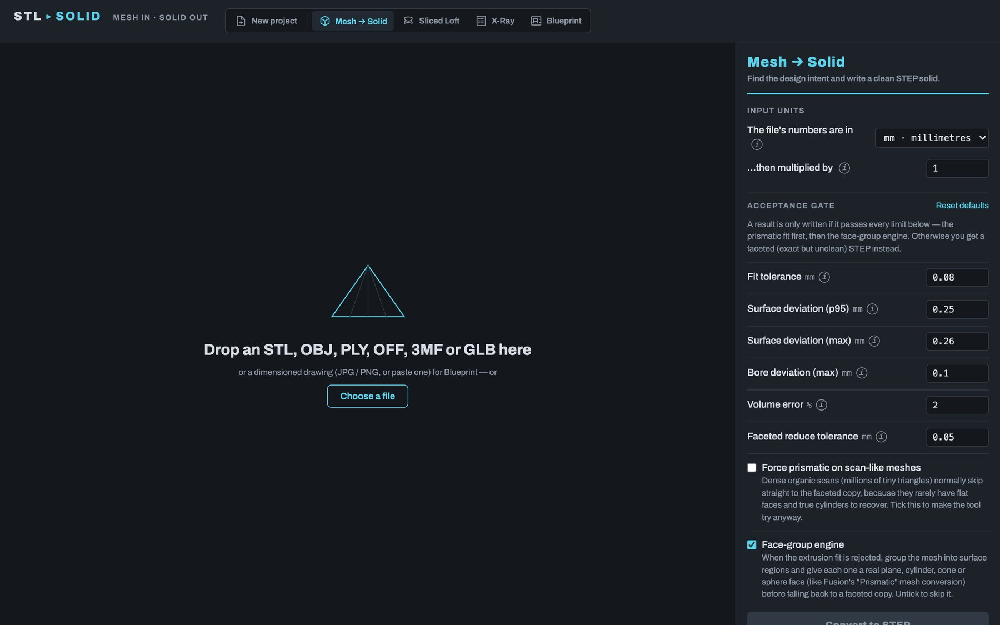
*The start screen, before a file is loaded.*

The window has three areas:

- **Top bar.** The **New project** button (start over with another file)
  and the four tool buttons: **Mesh → Solid**, **Sliced Loft**, **X-Ray**
  and **Blueprint**. The highlighted button is the active tool. Hover over
  a button for a one-line description.
- **Stage (left).** Drop a file here. Once loaded, it shows the part in 3D
  (or, for Blueprint, the drawing).
- **Rail (right).** The active tool's settings, its action button and,
  after a run, the report with the download buttons.

You can switch tools at any time. The loaded file stays, and each tool
keeps its own settings.

### 2.2 Loading a file

Drag a file onto the stage, or click **Choose a file**. You can also paste a
drawing image from the clipboard with **Cmd+V / Ctrl+V**.

- **Meshes:** `.stl`, `.obj`, `.ply`, `.off`, `.3mf`, `.glb`, `.gltf`. A
  mesh opens in the mesh tools. If Blueprint was active, the app switches
  to Mesh → Solid.
- **Drawings:** `.jpg`, `.png`, `.webp`. A drawing always opens in
  Blueprint.

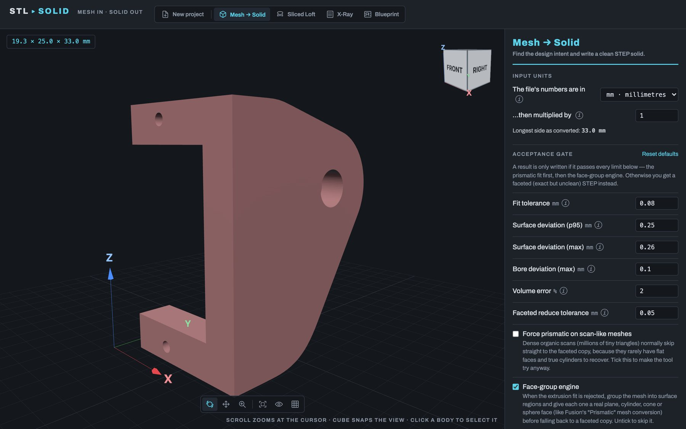
*A servo bracket loaded. Its size is in the top-left corner of the stage.*

The part's size appears in the top-left corner of the stage (for example
`19.3 × 25.0 × 33.0 mm`). After a run, the **Input mesh** table in the
report lists its triangle count, whether it is watertight (fully closed),
how many bodies it holds, its bounding box, surface area and volume.

To start again with a different file, click **New project**.

### 2.3 Input units and scale

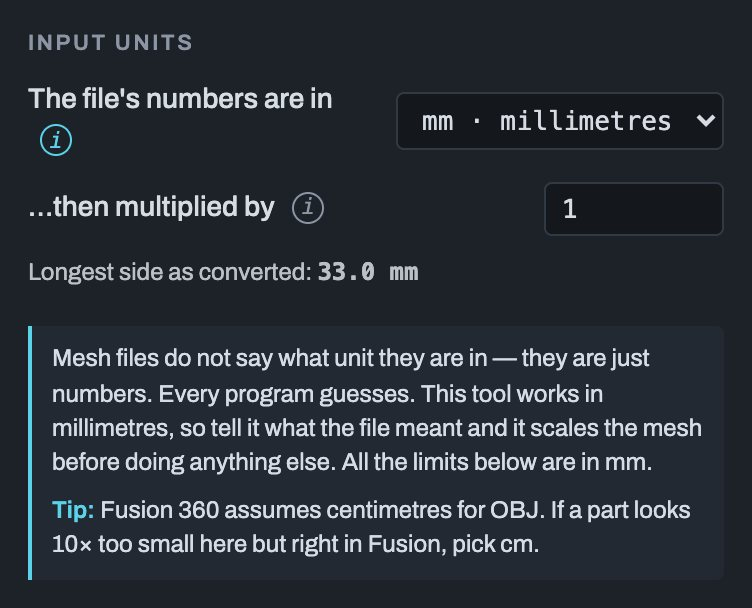
*Input units. The small **i** opens a plain-language explanation, shown here for the unit.*

Mesh files do not record their units. They are just numbers. stlToSolid
works in millimetres, so tell it what the file meant. These two settings
are shared by Mesh → Solid, Sliced Loft and X-Ray.

| Setting | Default | What it does |
|---|---|---|
| **The file's numbers are in** | mm | The unit the file was saved in: mm, cm, inches, feet or metres. The mesh is scaled to millimetres before anything else happens. |
| **…then multiplied by** | 1 | An extra factor on top of the unit. Units can only make a part bigger (cm is ×10, inches ×25.4), so use this to shrink one. For example, `0.1` fixes a part designed in centimetres but saved as millimetres. Leave it at `1` unless the size looks wrong. |

The line **Longest side as converted** shows the result, so you can spot a
wrong scale before a long conversion, not after. If the part looks
unusually large or small, a yellow **Check the size** note suggests a unit
or factor and offers a one-click **Use …** button.

> **Tip:** Fusion 360 assumes centimetres for OBJ files. If a part looks
> 10× too small in stlToSolid but right in Fusion, pick **cm**.

### 2.4 Picking bodies

Some files hold several separate pieces ("bodies"). A scanned controller,
for example, may have dozens. When that happens a **Bodies** panel appears
at the top of the rail.

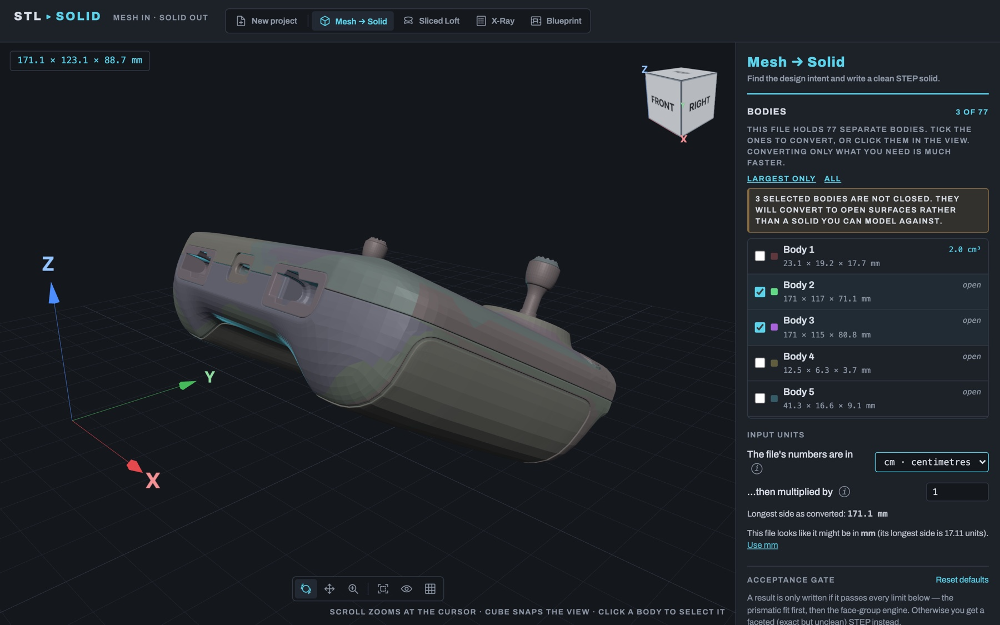
*A controller with 77 bodies. Each body has its own colour in the view and in the list.*

- Tick the bodies you want to convert, or **click them in the 3D view**.
  Hovering a row lights up that body.
- **Largest only** picks the main bodies. **All** ticks everything.
- Each row shows the body's size and volume. Bodies marked **open** are
  not closed. They convert to open surfaces rather than a solid, and a
  warning tells you when you have picked any.

Converting only what you need is much faster and uses much less memory.

### 2.5 Moving around the 3D view

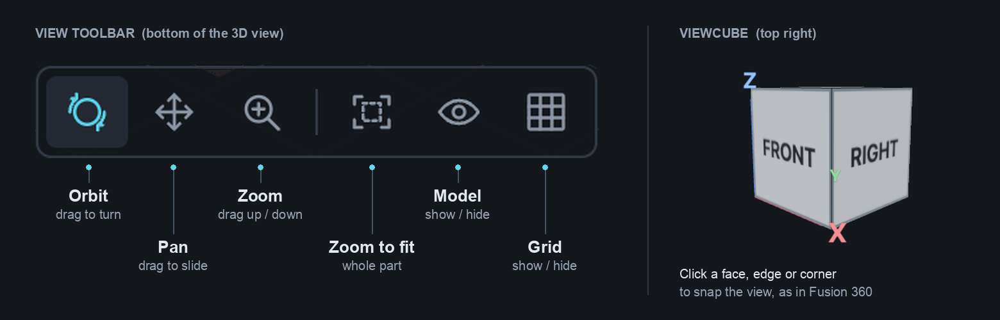
*The view toolbar sits at the bottom of the 3D view. The ViewCube sits in the top-right corner. The highlighted button is the active drag tool.*

| Control | What it does |
|---|---|
| **Scroll wheel** | Zooms in and out at the cursor. |
| **ViewCube** (top right) | Click a face, edge or corner to snap the view, as in Fusion 360. |
| **Orbit** (bottom toolbar) | Left-drag turns the view. |
| **Pan** | Left-drag slides the view. |
| **Zoom** | Left-drag up to zoom in, down to zoom out, at the point you press. |
| **Zoom to fit** | Frames the whole part. |
| **Eye** | Hides or shows the model. Slice traces stay visible. |
| **Grid** | Hides or shows the floor grid. |

The coloured triad shows the axes: **X red, Y green, Z blue**, the same as
Fusion 360.

---

## 3. Mesh → Solid

**What it does:** finds the design intent in a mesh (an extrusion
direction, flat faces, cylinders, cones, spheres) and writes a clean STEP
solid. It is the best tool for machined or CAD-designed parts.

### 3.1 How it works

The tool tries three routes, best first, and keeps the first one that
passes every quality check:

1. **Prismatic.** If the part is an extrusion (a sketch pulled straight),
   it redraws the outlines with lines and arcs and extrudes them. This is
   the cleanest result. It also gives you editable scripts.
2. **Face-group engine.** Otherwise it groups the mesh into surface regions
   and gives each one a real plane, cylinder, cone, sphere or torus face.
   This is the same idea as Fusion's paid "Prismatic" mesh conversion.
3. **Faceted.** If neither passes, you still get a valid, closed solid.
   Flat areas are merged into single faces and curved areas are
   simplified, but it is made of facets.

You always get a solid. The report tells you which route produced it.

### 3.2 Settings: the acceptance gate

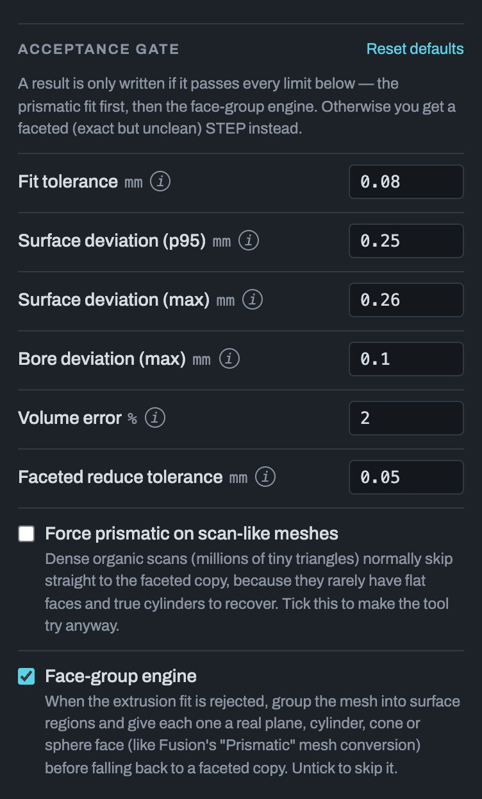
*The acceptance gate and the two options. Changed values are highlighted. **Reset defaults** puts them all back.*

A clean result is only written if it passes every limit. Click the small
**i** next to any setting for a plain-language explanation of what raising
or lowering it does.

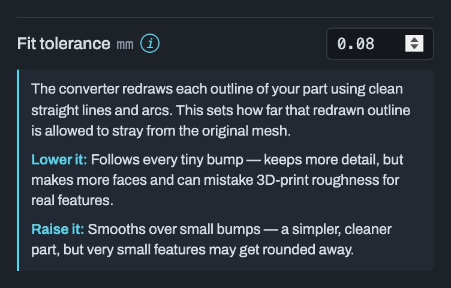
*The **i** button opens the explanation, with what happens when you lower or raise the value.*

| Setting | Default | What it means | Lower it | Raise it |
|---|---|---|---|---|
| **Fit tolerance** | 0.08 mm | How far the redrawn lines and arcs may stray from the mesh. | Follows every tiny bump. Keeps more detail, but makes more faces and can mistake 3D-print roughness for real features. | Smooths over small bumps. A simpler part, but very small features may get rounded away. |
| **Surface deviation (p95)** | 0.25 mm | 95 % of the surface must be closer than this to the original. This is the main quality bar. | Demands a near-perfect match. More parts fall back to the faceted copy. | Accepts a rougher match. More parts convert cleanly, but may visibly differ. |
| **Surface deviation (max)** | 0.26 mm | The limit for the single worst spot on the part. A taper, chamfer or rounded corner is usually what breaks it. | Even one slightly-off spot rejects the clean solid. | Lets one small area be off while the rest stays accurate. |
| **Bore deviation (max)** | 0.10 mm | A stricter limit for round holes, so screws and pins still fit. | Holes must be almost exactly the right size. | Only sensible when the holes are cosmetic. |
| **Volume error** | 2 % | The rebuilt part must hold about the same amount of material as the original. Catches a pocket that got filled in or a chunk that went missing. | Stricter overall shape check. | More forgiving. Rarely needs changing. |
| **Faceted reduce tolerance** | 0.05 mm | Only used for a faceted result: how far simplified curved areas may move from the original (like Fusion's *Reduce by tolerance*). `0` keeps every triangle. | Keeps more triangles. Closer to the mesh. | Fewer triangles and a smaller STEP. Small details may be smoothed. |

### 3.3 Settings: options

| Option | Default | What it does |
|---|---|---|
| **Force prismatic on scan-like meshes** | off | Dense organic scans (millions of tiny triangles) normally go straight to a faceted copy, because they rarely have flat faces and true cylinders to recover. Tick this to make the tool try anyway. |
| **Face-group engine** | on | When the extrusion fit is rejected, try route 2 (fitted planes, cylinders, cones, spheres and tori) before falling back to a faceted copy. Untick to skip it. |

### 3.4 Converting

Click **Convert to STEP**. The button shows *Converting…* (or *Waiting in
queue…*) while it works, and a **Cancel** button appears. Your file and
settings stay loaded if you cancel. Open **Pipeline log** under the report
to watch the steps.

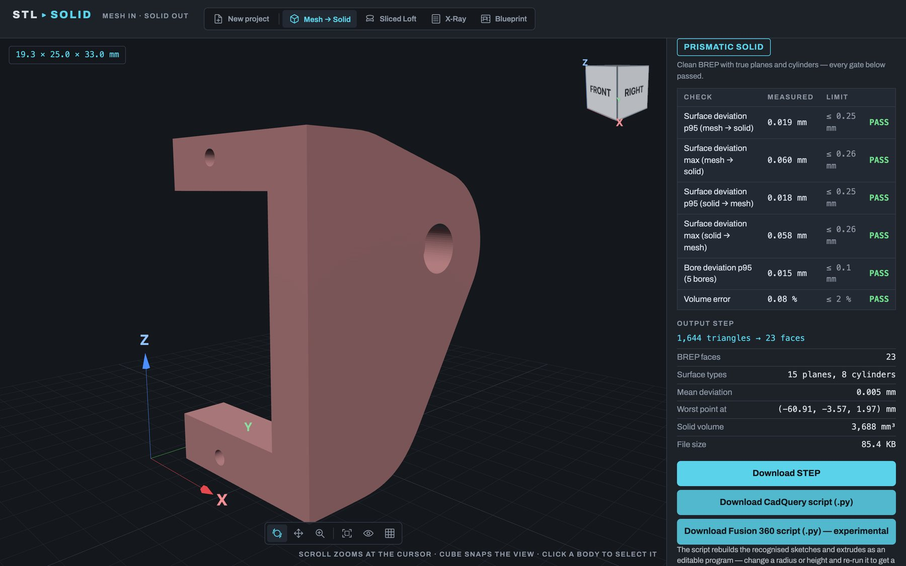
*The servo bracket as a prismatic solid: 1,644 triangles became 23 faces (15 planes and 8 cylinders). Every check passed.*

### 3.5 Downloads

- **Download STEP**: the solid. Import it into Fusion 360 or any CAD program.
- **Download CadQuery script (.py)**: for prismatic results. It rebuilds
  the recognised sketches and extrudes as an editable program. Change a
  radius or height and re-run it to get a new STEP.
- **Download Fusion 360 script (.py) — experimental**: for prismatic
  results. It rebuilds the part as a parametric Fusion timeline.
- **Download Fusion 360 script (Boundary Fill)**: for face-group results
  (experimental). Fusion rebuilds every fitted surface and computes the
  edges itself, so the solid has clean edges. The label says whether a test
  run predicts it will build (*experimental*), probably fail (*likely to
  fail*), or could not be checked (*not checked*). The STEP is fine either
  way.

How to run a script in Fusion is in [section 9](#9-using-the-results-in-fusion-360).

---

## 4. Sliced Loft

**What it does:** cuts the part into thin slices along one axis, redraws
each outline as a smooth curve and lofts the stack into one smooth solid.
It is what you would do by hand in Fusion with *Create Mesh Section Sketch →
Fit Curves to Mesh Section → Loft*, done automatically.

**Use it for:** shapes that change smoothly along one direction (lens caps,
handles, shells, bottles), flat plates with a fancy outline (sliced across
their thin side), and one smooth stretch of a mixed part (with **Loft
only**). **Not for:** machined parts with slots, sideways holes and steps.
A hole drilled across the slicing direction becomes a trough. Use Mesh →
Solid for those parts.

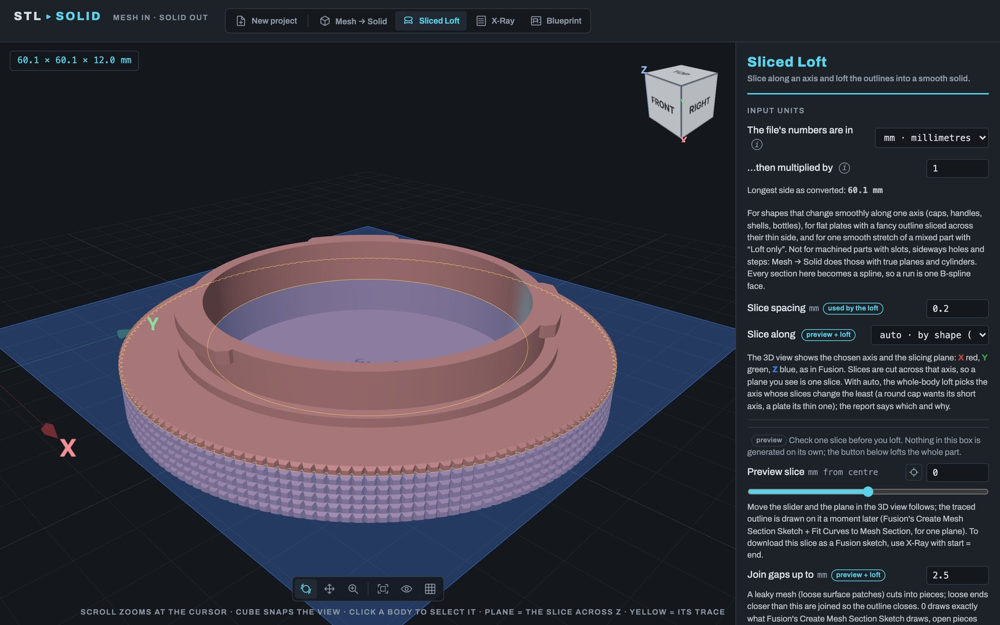
*A camera body cap in Sliced Loft. The blue plane is the preview slice. The yellow line is the outline traced on it.*

### 4.1 What the little tags mean

Some settings carry a small tag, so you can see which ones change the
solid:

- **used by the loft**: changes the solid the Convert button makes.
- **preview + loft**: changes both the preview slice and the solid.
- **preview only**: changes only the preview slice. The solid ignores it.

### 4.2 Settings: spacing and axis

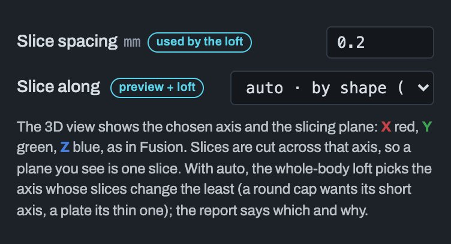

| Setting | Default | What it does |
|---|---|---|
| **Slice spacing** | 0.2 mm | Distance between slices. Smaller follows the shape more closely. The loft itself uses at most about 60 slices per run, but the checks still measure the result against every triangle of the mesh. |
| **Slice along** | auto | The axis to slice across. **auto · by shape** picks the axis whose slices change the least: a round cap wants its short axis, a plate its thin one. The list shows the part's length along each axis, and the report says which axis was picked and why. |

### 4.3 Settings: the preview slice

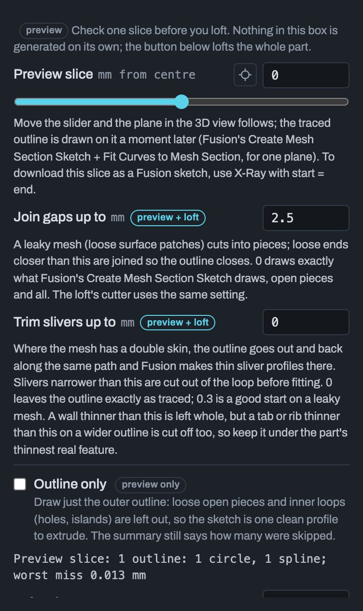
*Everything in the preview box is for checking one slice before you loft. The summary line at the bottom says what was found.*

| Setting | Default | What it does |
|---|---|---|
| **Preview slice** | 0 mm from centre | A slider and a number box that move one plane through the part. The traced outline appears on it a moment later. The **crosshair button** lets you click a face in the 3D view to put the plane there (Esc cancels). To download this one slice as a Fusion sketch, use X-Ray with start = end. |
| **Join gaps up to** | 2.5 mm | A leaky mesh (loose surface patches) cuts into open pieces. Loose ends closer than this are joined so the outline closes. `0` draws exactly what Fusion's own mesh section draws, open pieces and all. The loft uses the same value. |
| **Trim slivers up to** | 0 mm | Where a mesh has a double skin, the outline goes out and back along the same path and makes thin slivers. Slivers narrower than this are cut out before fitting. Keep it at `0` for a clean, watertight mesh (a warning appears if you don't). `0.3` is a good start for a leaky one. Keep it below the part's thinnest real rib or tab. |
| **Outline only** | off | Draws just the outer outline and leaves out holes and loose pieces. Preview only. |

The summary line reads like `Preview slice: 1 outline: 1 circle, 1 spline;
worst miss 0.013 mm`: how many closed outlines were found, what they are
made of, and how far the fitted curve is from the mesh at its worst point.

### 4.4 Settings: what to loft

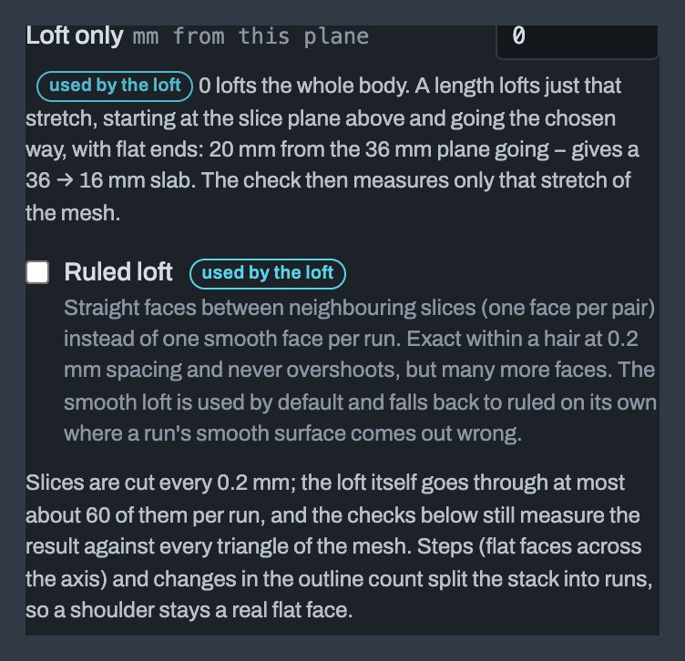

| Setting | Default | What it does |
|---|---|---|
| **Loft only … mm from this plane** | 0 | `0` lofts the whole body. A length lofts just that stretch, starting at the preview plane, with flat ends. The preview slider is then labelled **Loft starts at**. For example, 20 mm from the 36 mm plane going − gives a 36 → 16 mm slab. The check then measures only that stretch of the mesh. |
| **Going** | − | Shown when Loft only is above 0. **+** goes along the axis arrow, **−** against it. |
| **Ruled loft** | off | Straight faces between neighbouring slices (one face per pair) instead of one smooth face per run. Exact within a hair at 0.2 mm spacing and never overshoots, but many more faces. The smooth loft switches to ruled by itself for any run whose smooth surface comes out wrong. |

The acceptance gate appears below these settings too (see section 3.2).
With Sliced Loft the limits are **measured and shown, not enforced**: you
chose the method, so its solid is written whenever it can be built. Only a
loft that cannot be built at all falls back to a faceted copy.

### 4.5 Converting and downloads

Click **Convert to STEP**. The stack is split into *runs* wherever a flat
step crosses the axis or the number of outlines changes, so a shoulder
stays a real flat face. Each run becomes one smooth face. Holes along the
axis are lofted and cut.

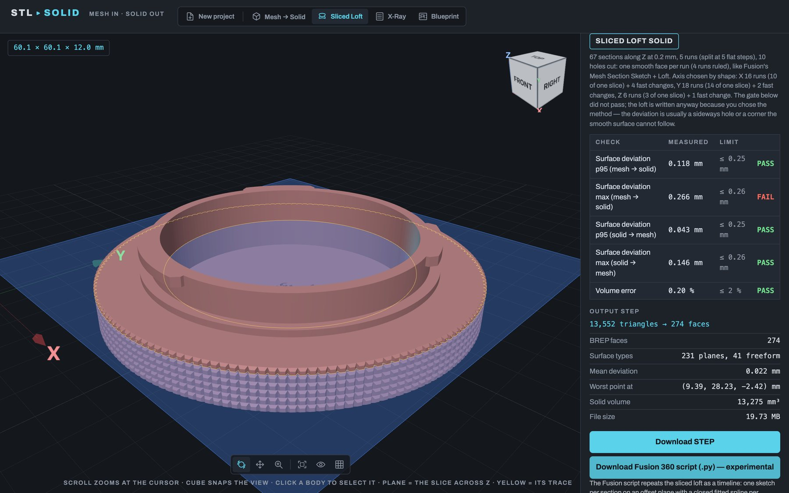
*The body cap as a sliced loft solid. The summary explains the sections, runs and chosen axis. Here one strict check (max deviation, 0.266 mm against 0.26 mm) is just over its limit. It is reported, but the solid is still written.*

**Downloads:** **Download STEP** and **Download Fusion 360 script (.py)
— experimental**. The script repeats the loft as a Fusion timeline: one
sketch per section on an offset plane, then one Loft per run, with holes
as Loft cuts.

---

## 5. X-Ray

**What it does:** cuts the part at as many planes as you like and turns
each cut into a **real Fusion 360 sketch**: clean lines, arcs and splines
that join into closed profiles. You can click a profile and extrude it,
offset it, or dimension against it, like a sketch you drew yourself.

**Why this matters.** Fusion's own *Create Mesh Section Sketch* gives you
an outline made of hundreds or thousands of separate points. You cannot
select it as a profile or extrude it, so in practice you have to draw a new
sketch around the shape by hand. X-Ray does that redrawing for you, for
every slice at once.

| | Fusion mesh section sketch | X-Ray sketch |
|---|---|---|
| Made of | Hundreds or thousands of points | A few lines, arcs and splines |
| Closed profile you can select | No | Yes |
| Extrude, offset, dimension | Only after you trace it by hand | Straight away |
| Many slices | One plane at a time | A whole stack in one script |

X-Ray does not make a STEP. It downloads one Fusion 360 script that
draws the sketches, each on its own plane, so you can model in Fusion
yourself. It can also extrude every slice into a solid slab for you. If
the mesh is already in a Fusion design, the
[Mesh to Outline add-in](#7-fusion-360-add-in-mesh-to-outline) does the
same thing without a download.

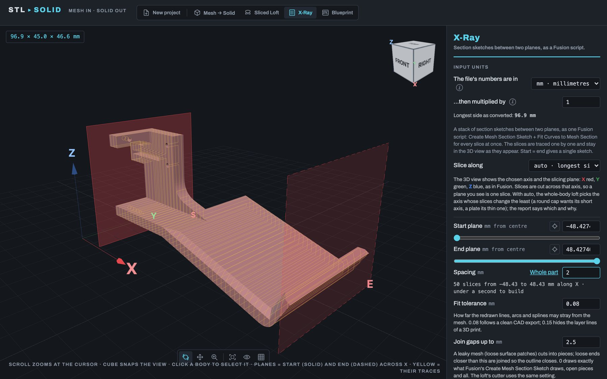
*X-Ray on a frame, sliced along X every 2 mm over the whole part (50 slices). S is the start plane (solid), E the end plane (dashed). Each yellow outline is one traced slice, ready to become a Fusion sketch.*

### 5.1 Settings: where to slice

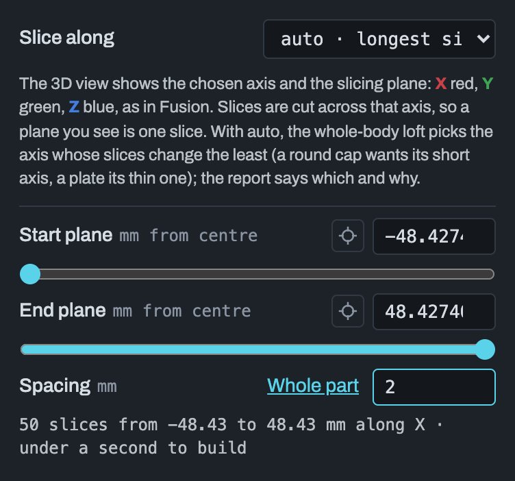

| Setting | Default | What it does |
|---|---|---|
| **Slice along** | auto | The axis to slice across. In X-Ray, **auto** uses the longest side. |
| **Start plane / End plane** | 0 mm from centre | Where the stack begins and ends, in mm from the part's centre. Each has a slider, a number box and a **crosshair button**: press it, then click a face in the 3D view to put the plane there. Start = end gives a single sketch. Start past end is fine. |
| **Spacing** | 0.2 mm | Distance between slices. **Whole part** moves the planes to both ends of the part. The line below shows the slice count and an estimated build time. |

### 5.2 Settings: how each slice is traced

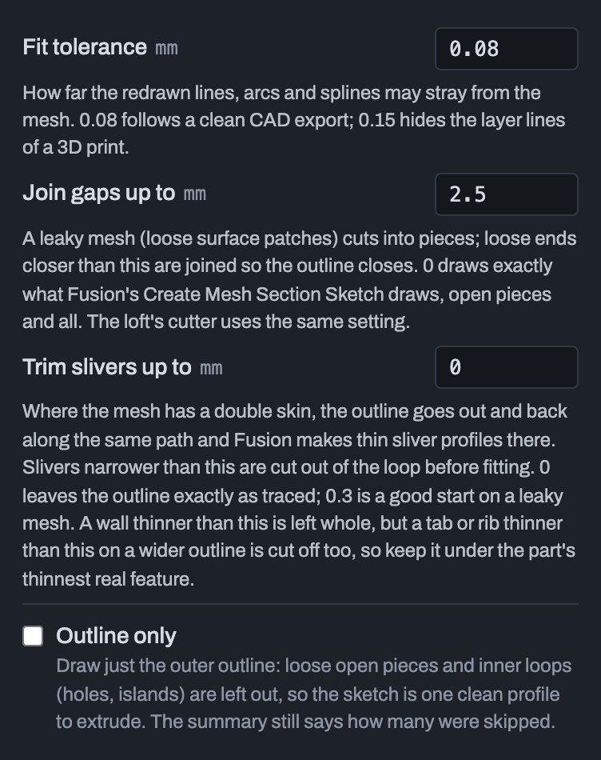

| Setting | Default | What it does |
|---|---|---|
| **Fit tolerance** | 0.08 mm | How far the fitted lines, arcs and splines may stray from the mesh. `0.08` follows a clean CAD export. `0.15` hides the layer lines of a 3D print. |
| **Join gaps up to** | 2.5 mm | As in Sliced Loft (section 4.3). X-Ray keeps its own value. |
| **Trim slivers up to** | 0 mm | As in Sliced Loft. X-Ray keeps its own value, so a trim set for a leaky loft does not eat the thin walls of the next part. If slivers were trimmed anywhere in the stack, a note says in how many slices. |
| **Outline only** | off | Just the outer outline of each slice: holes, islands and loose pieces are left out. About five times faster on organic shapes. |

### 5.3 Settings: slabs and the download

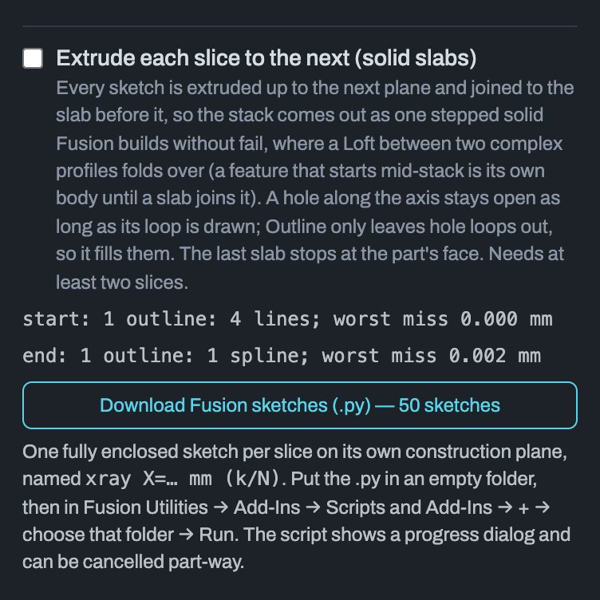
*The start and end summaries say what the two end slices hold. The download button shows how many sketches the script will draw.*

| Setting | Default | What it does |
|---|---|---|
| **Extrude each slice to the next (solid slabs)** | off | The script also extrudes every sketch up to the next plane and joins the slabs, giving one stepped solid that Fusion always builds. (A Loft between two complex profiles often folds over.) Holes along the axis stay open as long as their loops are drawn. Outline only leaves hole loops out, so it fills them. Needs at least two slices. |

The slices are traced one by one and stay in the view as they appear.
Click **stop** to halt the tracing and **trace the rest** to carry on.

Click **Download Fusion sketches (.py)**. The server fits every slice
(*Working…* with a spinner) and then hands you the script. Each slice
becomes a fully enclosed sketch on its own construction plane, named like
`xray X=-18.50 mm (3/24)`. In Fusion, the script shows a progress dialog and
can be cancelled part-way.

**Limits:** at most 500 slices and about 4 minutes of fitting per download.
If you go over, raise the spacing, narrow the range, or tick **Outline
only**.

---

## 6. Blueprint

**What it does:** starts from a picture instead of a mesh. Drop or paste a
dimensioned drawing (front, top and side views with their labels, like a
datasheet). A vision AI model of your choice reads the labels into a small
**recipe**: named parameters in millimetres and a short list of sketch +
extrude features. The part is built from those numbers, so you can fix any
it misread and rebuild. You get a **parametric Fusion 360 script**, a STEP
and a 3D preview.

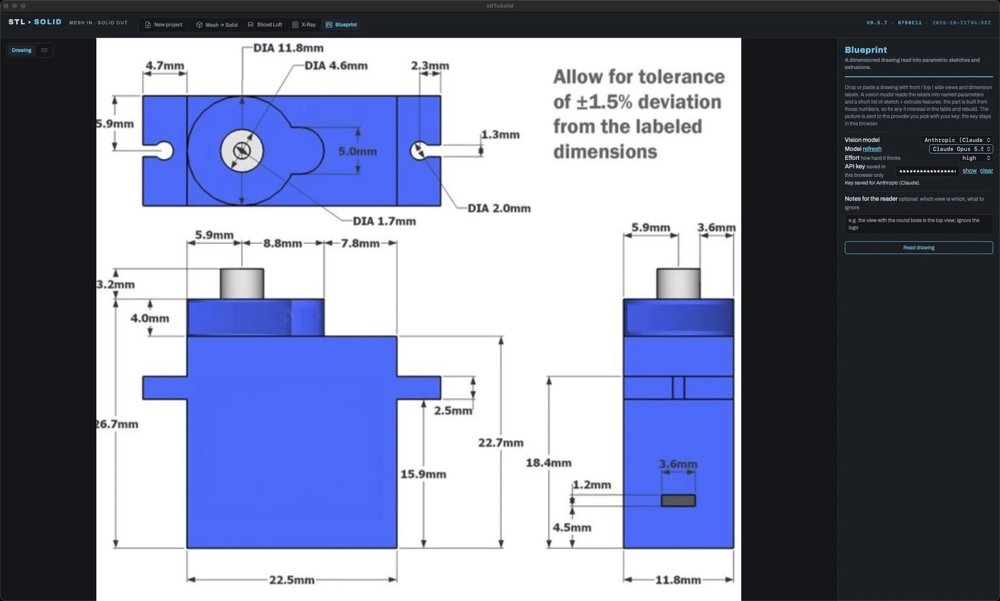
*A micro-servo datasheet drawing loaded in Blueprint, ready to read.*

### 6.1 Settings: reading the drawing

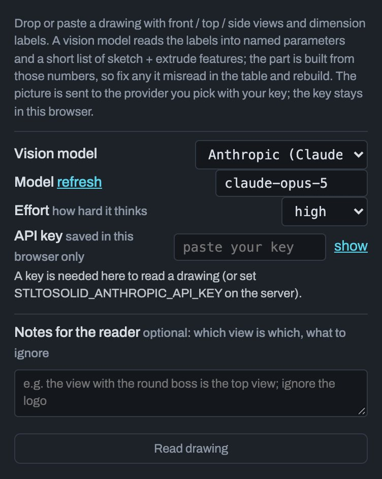

| Setting | Default | What it does |
|---|---|---|
| **Vision model** | Anthropic (Claude) | The provider that reads the drawing: Anthropic (Claude), OpenAI, DeepSeek, or *Custom* (any OpenAI-compatible server, such as Ollama running a vision model on your own computer, or OpenRouter). |
| **Model** | the provider's default | Choose from the list, click **refresh** to ask the provider again, or pick *type a name…* to enter one. |
| **Effort** | high | How hard the model thinks. *high* is the most careful, slowest and most expensive. *medium* takes about half the time. *low* is a quick look. |
| **Base URL** | — | *Custom* only: the server's address, for example `http://localhost:11434/v1` for Ollama. |
| **API key** | empty | Your key for that provider. **show** reveals it, **clear** removes it. It is saved in this browser (or app) only and sent with each read. The server never stores it. Local servers usually need no key. |
| **Notes for the reader** | empty | Optional hints, for example *"the view with the round boss is the top view; ignore the logo"*. |

Click **Read drawing**. A **Cancel** button appears while it reads.

> **Privacy:** the drawing is sent to the provider you pick, with your key,
> and nowhere else. Choose a local model if the drawing must stay on your
> computer.

### 6.2 Checking and editing the recipe

When the read finishes, the part is built and the stage switches to the
**3D** tab. Use the **Drawing | 3D** tabs to switch between the picture and
the model.

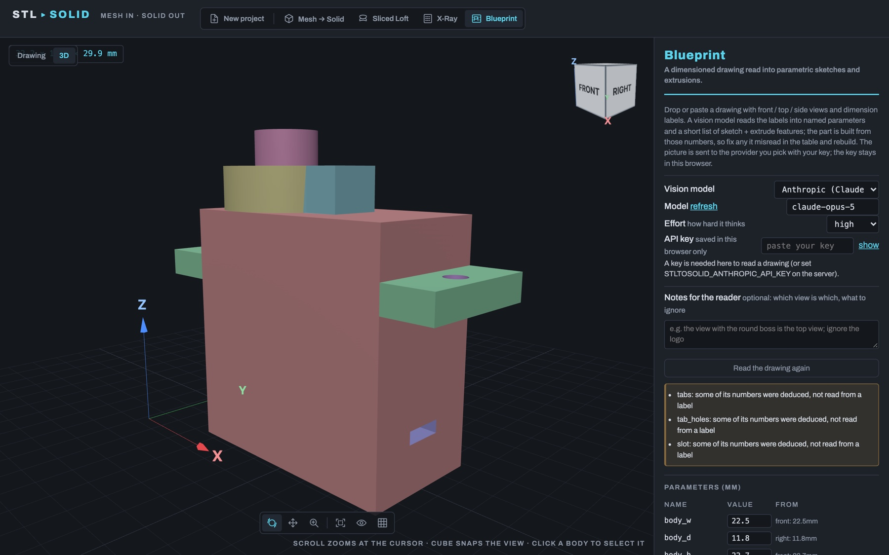
*The built servo. Each feature has its own colour.*

Before anything is built, the recipe goes through automatic checks: every
value must resolve, shapes must have a size, cuts must remove something,
and the overall size must match the drawing. Problems and guesses are
listed in a yellow box.

**Parameters (mm).** Every number, with **From** saying where it came from
(for example `front: 22.5mm`). A **?** marks a value the model had to
deduce rather than read from a label. Check those first.

**Features.** Each feature has a colour swatch that matches the 3D view.
Hover a feature to light it up. For each feature you can see and edit:

- the operation (**new body**, **join** or **cut**) and its sketch plane
  (XY = top view, XZ = front, YZ = right side),
- **offset**, direction (**+**, **−** or **sym**) and **distance**, or
  **through all** for cuts,
- its shapes (rectangle, circle, slot, polygon) with their positions and
  sizes (`cu`/`cv` = centre, `w`/`h` = width and height, `r` = corner
  radius, `d` = diameter). A **low** badge marks a feature the model was
  unsure of.

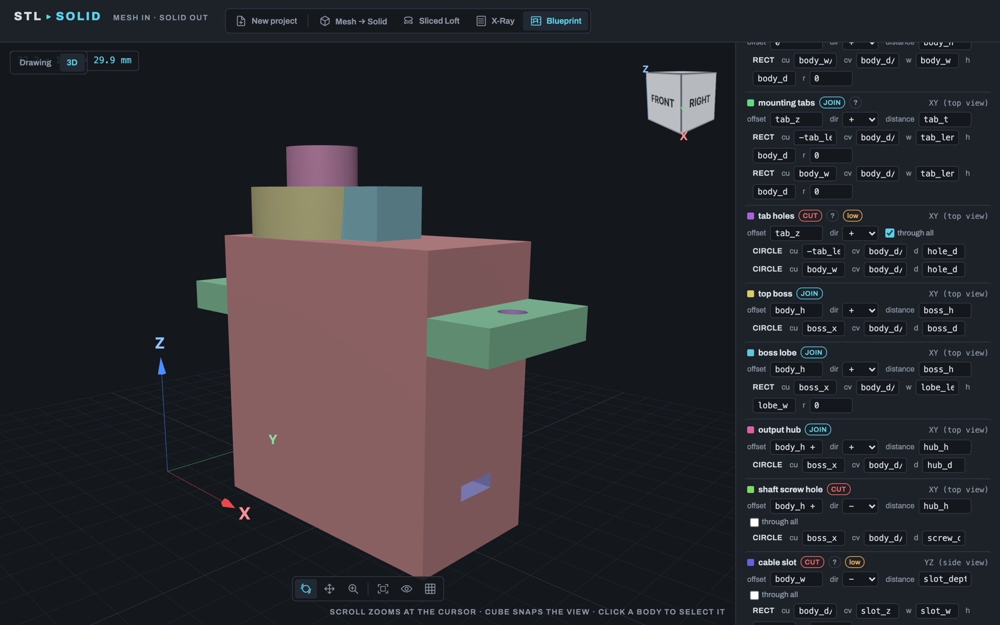
*The feature list. Values can be numbers or expressions such as `body_w/2`.*

Any value can be a number or an expression over the parameters, like
`body_w/2`. Change a value and the 3D view redraws within about a second
(*Redrawing object…*). Click **Revert** to undo your edits.

### 6.3 Rebuilding and downloading

Click **Rebuild with these values (STEP + Fusion script)**. This runs the
checks and the build again **without** asking the AI model, so it costs
nothing.

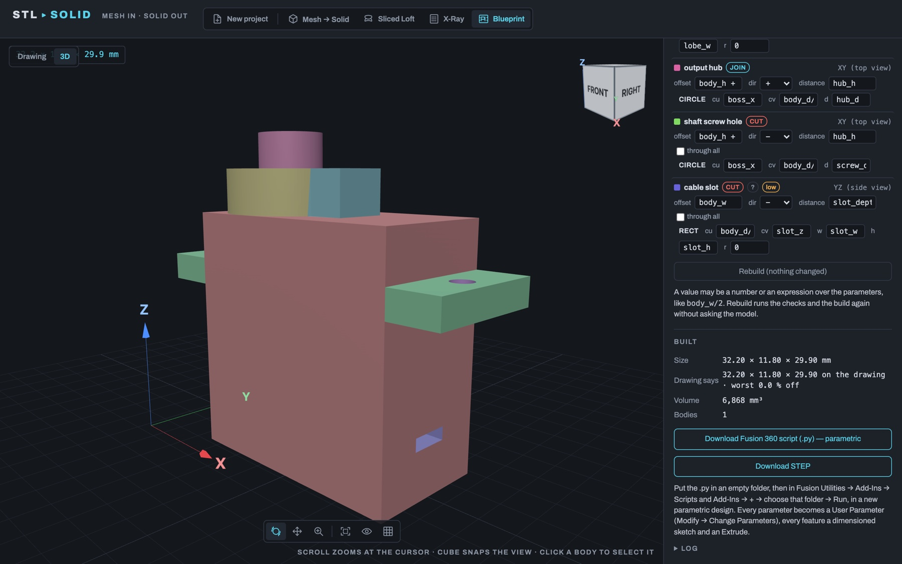
*The Built table compares the model's size with the size stated on the drawing.*

The **Built** table shows the size, what the drawing says (and how far off
the worst dimension is), the volume, the number of bodies, and which model
read the drawing. Then:

- **Download Fusion 360 script (.py) — parametric.** Every parameter
  becomes a Fusion **User Parameter** (*Modify → Change Parameters*), and
  every feature becomes a dimensioned sketch and an Extrude. Change
  `body_h` in Fusion and the parts on top move with it.
- **Download STEP.** The same part as a plain solid.

Click **Read the drawing again** to start over with a fresh read.

---

## 7. Fusion 360 add-in: Mesh to Outline

**What it does:** the X-Ray and single-slice tracing, running inside Fusion
360 itself. Pick a mesh body and a plane, and it draws the section as a
normal sketch of lines, arcs, circles and fitted splines. Or pick a start
and an end and it draws a whole stack, and can extrude it into one solid.
It is Fusion's *Create Mesh Section Sketch* followed by *Fit Curves to Mesh
Section*, in one button, for as many planes as you like.

It runs on Fusion's own Python. Nothing is uploaded, and no server or app is
needed.

*Mesh to Outline on a scanned controller in Fusion 360.*

### 7.1 Installing

> The add-ins are not in a public release yet. The website's add-ins
> button says *coming soon* until they are.

1. Download the add-ins zip from the latest release and unzip it.
2. Copy the `MeshSectionSketch` folder into Fusion's add-ins folder:
   - **Mac:** `~/Library/Application Support/Autodesk/Autodesk Fusion 360/API/AddIns/`
   - **Windows:** `%APPDATA%\Autodesk\Autodesk Fusion 360\API\AddIns\`
3. In Fusion: **Utilities → Add-Ins → Scripts and Add-Ins → Add-Ins** tab,
   select **MeshSectionSketch** and click **Run**. It starts with Fusion
   from then on.

It needs a current Fusion (with its built-in Python 3.14). numpy comes
inside the add-in.

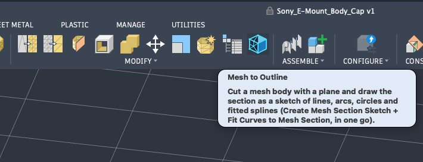
*The button sits on the **Mesh** tab, in the **Modify** panel, next to Convert Mesh.*

If the Mesh panel is not found, the button goes under **Utilities →
Add-Ins** instead. The Text Commands palette says where.

### 7.2 Before you start

1. **Insert → Insert Mesh**, and set the units to mm.
2. For a single section or a stack: make a construction plane where you
   want the cut (**Construct → Offset Plane**), or use any flat face.
3. **Mesh** tab → **Modify** → **Mesh to Outline**.

### 7.3 The settings

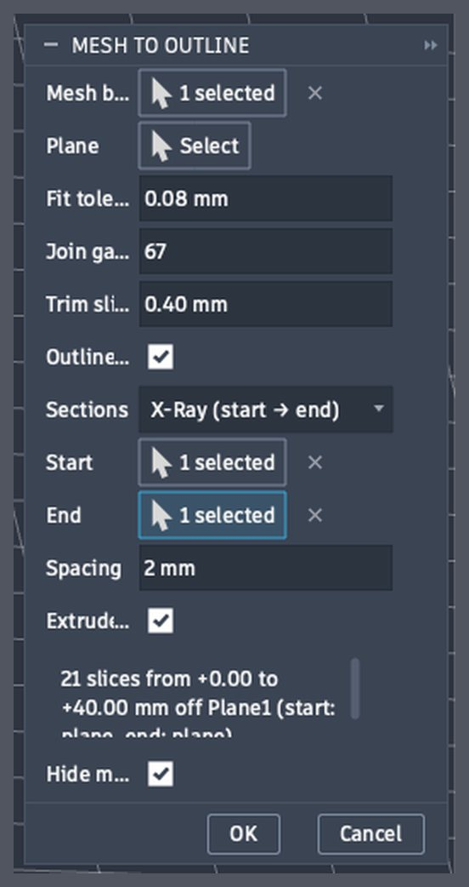
*The dialog in X-Ray mode. The values shown are from one run on a leaky scanned controller, not the defaults. Fusion cuts the labels short. The full names are in the table below.*

| Setting | Default | What it does |
|---|---|---|
| **Mesh body** | — | The mesh body to cut. |
| **Plane** | — | A construction plane or a flat face to cut on. In X-Ray mode it is optional: it only sets the slice direction (see below). |
| **Fit tolerance** | 0.08 mm | How far a fitted curve may sit off the raw section. |
| **Join gaps up to** | 2.5 mm | Loose ends closer than this are joined, so an outline broken only by hairline cracks between surface patches comes back as one closed profile. `0` draws exactly what Fusion's own mesh section draws. Raise it if the outline still comes back in pieces. Lower it if two unrelated pieces got joined. |
| **Trim slivers up to** | 0 mm | Where the mesh has a double skin, the outline goes out and back along the same path and Fusion makes thin sliver profiles. Slivers narrower than this are cut out before fitting. `0.3` is a good start on a leaky mesh. `0` leaves the outline as traced. |
| **Outline only** | off | Just the outer outline. Loose open pieces and inner loops (holes, islands) are skipped, so each sketch is one clean profile to extrude. The summary still says how many were skipped. |
| **Sections** | One | **One**: a single sketch on the plane. **Stack (count + direction)**: several sketches on offset planes. **X-Ray (start → end)**: a stack between two picks, like the app's X-Ray. |
| **Spacing** | 0.2 mm | Stack and X-Ray: the distance between sketches. |
| **Sections** (count) | 10 | Stack only: how many sketches, 2 to 400. |
| **Direction** | Along the plane normal (+) | Stack only: along the plane's normal (+), against it (−), or both sides of it. |
| **Start / End** | — | X-Ray only: where the stack starts and ends. Pick a construction plane or flat face parallel to the slicing plane, or click on the mesh. A click on a flat mesh face across the slice direction snaps to that face (just inside the material, so the cut catches it). A click anywhere else takes the height of the spot clicked. The end is always included, and start past end is fine. |
| **Extrude each slice** | off | Stack and X-Ray: each sketch's profile is extruded to the next slice and joined into one body, a stepped solid. Use this instead of Loft, which usually fails between two complex profiles. With Outline only ticked, only the outer shape is extruded. Without it, inner loops are filled as well. At 0.5 mm spacing the steps are hard to see. |
| *(info line)* | — | X-Ray only: how many slices your picks and spacing make, and between which heights. |
| **Hide mesh after** | off | Hides the mesh body when it is done, so you can see the result. |

**The plane in X-Ray mode.** If you leave **Plane** empty, the slices run
parallel to the Start plane (or the End plane). You need a Plane only when
both Start and End are clicks on the mesh.

### 7.4 Walk-through: from mesh to solid with X-Ray

This is a real run on a scanned controller: 21 slices, 2 mm apart, then
extruded into one body.

**1. Pick two planes.** Choose the mesh body, set **Sections** to **X-Ray
(start → end)**, and pick a Start and an End. Set the **Spacing**. The info
line says how many slices that makes (here 21, from +0.00 to +40.00 mm).
Tick **Extrude each slice** if you want a solid, then click **OK**.

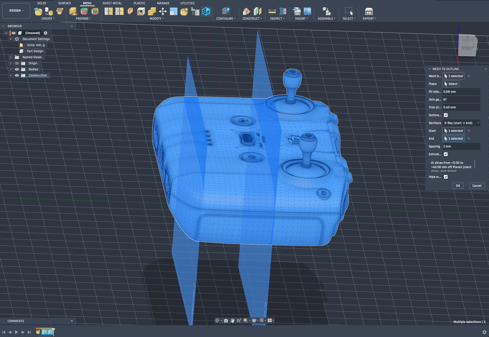

**2. Watch it trace.** Each slice is cut and fitted in turn. A progress
dialog counts the sections. **Cancel** stops it after the current one.

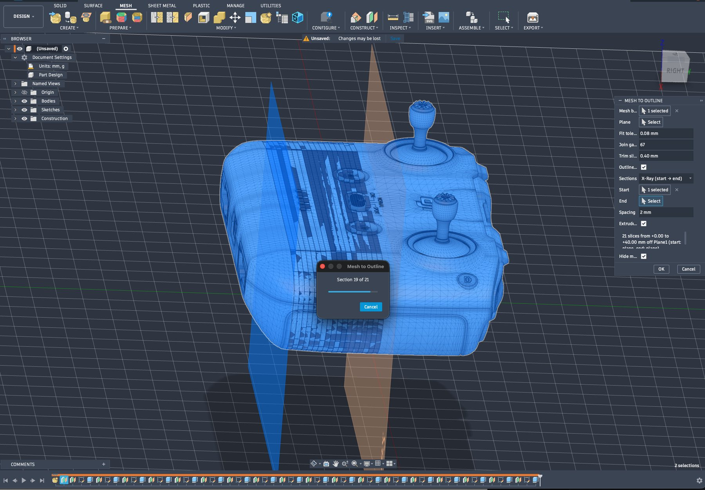

**3. One sketch per slice.** Every slice lands as its own sketch on its
own plane, listed in the browser from first to last and named like
`xray Plane1 +4.00 mm (3/21)`. When it finishes, a message box lists each
sketch with what it holds (outlines, open curves, lines, arcs, circles,
splines, gaps joined, worst miss).

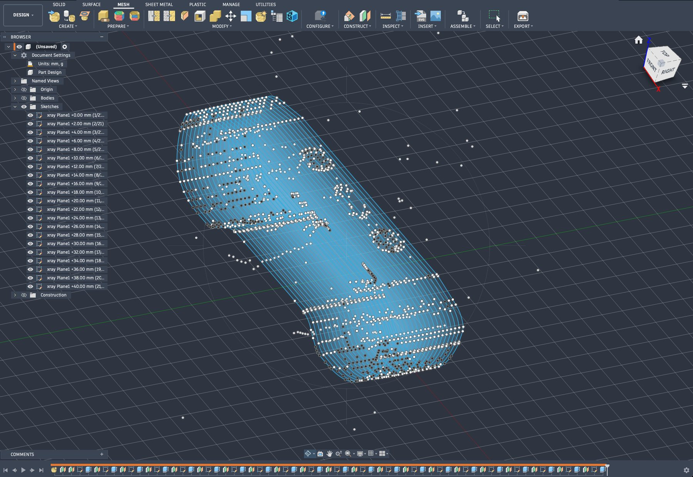

**4. A closed profile, every time.** Open any sketch: it is one closed
outline that Fusion sees as a profile, ready to extrude, offset or
dimension.

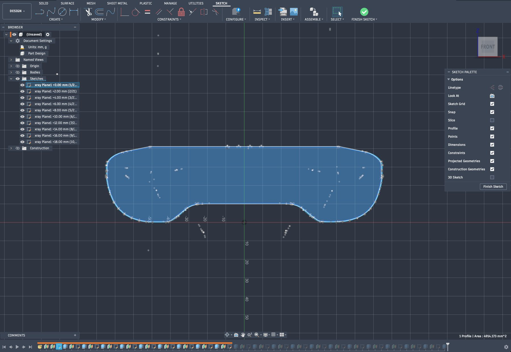

**5. A solid you can design on.** With **Extrude each slice** ticked, the
stack becomes one stepped solid body in the timeline, next to the mesh.

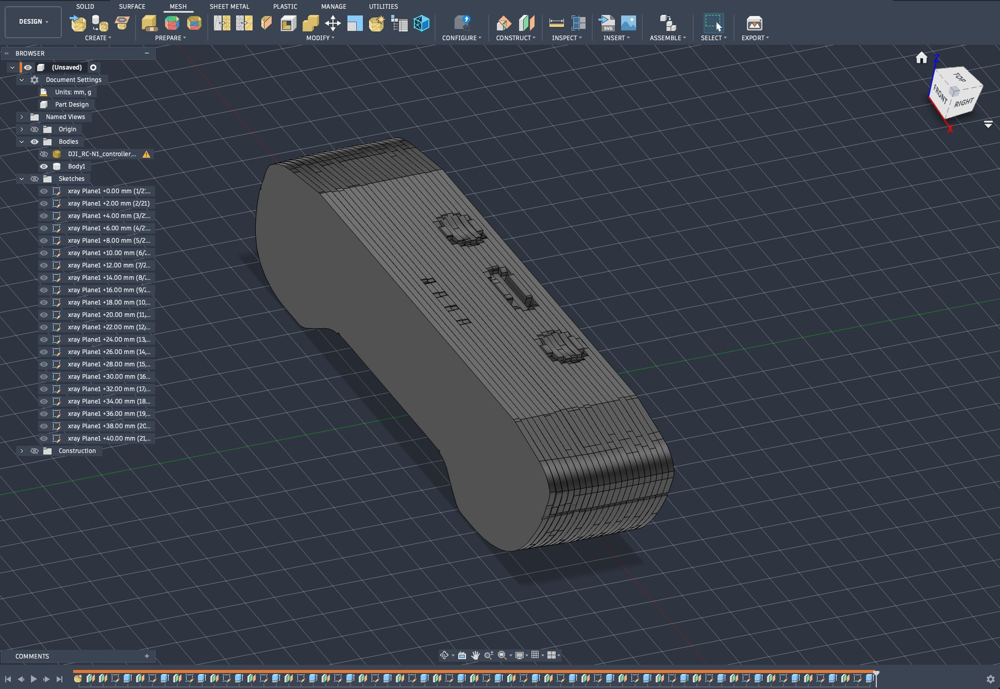

A single section takes a second or two on a 300,000-triangle mesh. The
sketches go in the root component. A mesh inside a component is read in
root coordinates, so the curves land on the mesh either way.

### 7.5 Messages you may see

| Message | What to do |
|---|---|
| *Empty cut skipped* | The plane misses the mesh there. Fusion's own section sketch would be empty too. |
| *WARNING: the outline did not close in N slices* | The mesh has holes wider than **Join gaps** at those slices (a vent grille's slots, say). Those outlines stay open, Outline only drops them, and those slices get no slab, which leaves a groove in the solid. Raise Join gaps to the value the warning gives and run again. |
| *WARNING: N slabs could not be extruded* | The sketch was drawn, but Fusion found no profile to extrude there. The per-slice list says why. |
| *numpy could not be imported* / *Fusion's Python is now X.Y* | Fusion updated its Python. Install the matching add-in version. |

### 7.6 STL to Solid add-in (preview)

A second add-in, **STL to Solid**, sits next to Mesh to Outline. It does
the face-group conversion (section 3.1, route 2) inside Fusion: it fits
planes, cylinders, cones, spheres and tori to a mesh body, builds each one
slightly oversized as a surface, and lets Fusion's Boundary Fill keep the
material. It is an early preview. It works on clean, CAD-like meshes, and
refuses open shells and scans.

| Setting | Default | What it does |
|---|---|---|
| **Mesh bodies** | — | The mesh bodies to convert. |
| **Fit tolerance** | 0.08 mm | How far a triangle may sit off a fitted surface. |
| **Expand surfaces** | 1.0 mm | How far each surface is grown past its region, so neighbours overlap for Boundary Fill. |
| **Max regions** | 200 | Bodies with more fitted surfaces than this are refused. |
| **Keep tool surfaces** | off | Keeps the surface bodies (hidden) after the fill, for checking. |
| **Run Boundary Fill** | on | Untick to only create the surfaces and run Boundary Fill yourself. |
| **Hide mesh after** | on | Hides the mesh body when a solid was made. |
| **Diagnose rejected tools (slow)** | off | If Fusion refuses the fill, finds which surface it rejects. |

If the log says *Fusion could not compute the cells*, try Expand 0.5 or
2 mm, or use Mesh → Solid in the app instead.

---

## 8. Reading the report

After a Mesh → Solid or Sliced Loft run, the rail scrolls to the report.

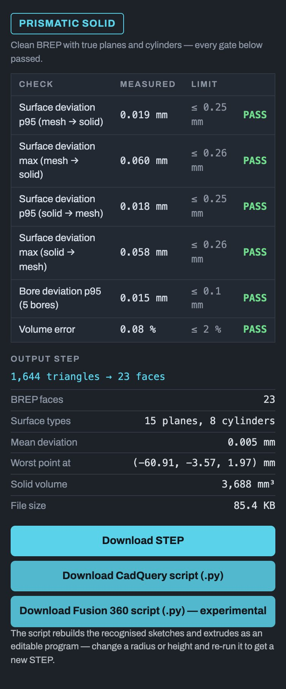
*The result badge, the checks table and the output summary for the servo bracket.*

**Input mesh.** The file as read: triangles, vertices, watertight or not,
bodies, bounding box, edge lengths, surface area, volume and file size.

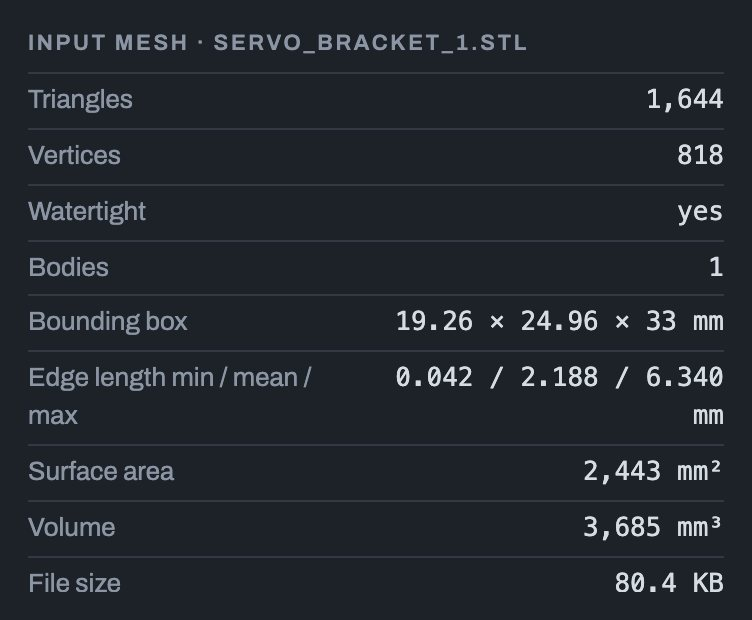

**Result badge.** Which route made the solid:

| Badge | Meaning |
|---|---|
| **Prismatic solid** | A clean extrusion with true planes and cylinders. Every check passed. Scripts are offered. |
| **Face-group solid** | Surface regions fitted with real planes, cylinders, cones, spheres and tori. |
| **Sliced loft solid** | The sliced loft. Checks are shown for information. |
| **Faceted solid** | No clean fit passed. The solid is exact and closed, but made of facets. |

**Bodies table** (multi-body files). One row per body: its triangle count,
which route it took and details.

**Checks table.** Each check with the measured value, the limit and
**PASS** or **FAIL**. Deviation is measured both ways: from the mesh to the
solid and from the solid to the mesh.

**Output STEP.** The headline shows the reduction, for example
`1,644 triangles → 23 faces`. Below it: face count, surface types, mean
deviation, where the worst point is, the solid's volume and the file size.

**Surfaces, not solids.** If the bodies you picked were not closed, the STEP
holds surfaces instead of a solid. You can measure them and snap to them,
but you cannot cut or join them.

---

## 9. Using the results in Fusion 360

### Importing a STEP

In Fusion 360 choose **File → Open → Open from my computer**, or drag the
`.step` file into the Data Panel. The part arrives as a solid body with
real faces you can sketch on, measure and constrain.

### Running a downloaded script

All the Fusion scripts (Mesh → Solid, Sliced Loft, X-Ray and Blueprint) run
the same way:

1. Put the `.py` file in an **empty folder of its own**.
2. In Fusion 360: **Utilities → Add-Ins → Scripts and Add-Ins**.
3. Click **+**, choose that folder, then click **Run**.

For Blueprint, run it in a **new parametric design**. Longer scripts show a
progress dialog with a Cancel button. For more detail, open **View → Show
Text Commands**.

---

## 10. Troubleshooting

| Problem | What to do |
|---|---|
| The part is 10× (or 25.4×) too big or small | Change **The file's numbers are in**, or use **…then multiplied by** (for example `0.1`). Watch **Longest side as converted**. |
| I got a **Faceted solid** instead of a clean one | Open the checks table to see which limit failed. Try a slightly larger **Fit tolerance** or **Surface deviation (max)**. For smooth organic shapes, try **Sliced Loft**. |
| Conversion runs out of memory (*oom*) | Tick fewer bodies. Each body converted at the same time can use several gigabytes. |
| Conversion *crashed* | The geometry kernel gave up on one face. Pick fewer bodies, raise the tolerance, or try Sliced Loft. |
| The result is surfaces, not a solid | The picked bodies are not closed (marked **open**). Pick closed bodies, or repair the mesh first. |
| A slice outline is broken into pieces | The mesh is leaky. Raise **Join gaps up to**. |
| Thin slivers or hairpins in the outline | Raise **Trim slivers up to** a little, but keep it below the part's thinnest real feature. |
| A thin rib or tab vanished from a slice | **Trim slivers up to** is too high. Lower it, or set it to `0` on a watertight mesh. |
| X-Ray says too many slices or over the time limit | Raise the spacing, narrow the start and end planes, or tick **Outline only**. |
| Sliced Loft turns a sideways hole into a trough | That is a limit of slicing. Use Mesh → Solid for machined parts. |
| Blueprint says a key is needed | Paste an API key for the chosen provider, or pick a local *Custom* server. |
| Blueprint misread a number | Fix it in the **Parameters** table and click **Rebuild**. No new read is needed. |
| Mesh to Outline left a groove in the extruded solid | Some slices did not close. Raise **Join gaps up to** to the value the warning gives. |
| A red banner appears at the top | Read the message. Open **details** for more, then dismiss it with **×**. Your file and settings stay loaded. |

---

## 11. Quick reference

### File types

| Kind | Extensions | Opens in |
|---|---|---|
| Mesh | `.stl` `.obj` `.ply` `.off` `.3mf` `.glb` `.gltf` | Mesh → Solid, Sliced Loft, X-Ray |
| Drawing | `.jpg` `.png` `.webp` (or paste from the clipboard) | Blueprint |

### Default settings

| Setting | Default |
|---|---|
| Units / multiplier | mm / 1 |
| Fit tolerance | 0.08 mm |
| Surface deviation p95 / max | 0.25 mm / 0.26 mm |
| Bore deviation (max) | 0.10 mm |
| Volume error | 2 % |
| Faceted reduce tolerance | 0.05 mm |
| Slice spacing (Sliced Loft, X-Ray, Mesh to Outline) | 0.2 mm |
| Join gaps up to | 2.5 mm |
| Trim slivers up to | 0 mm |
| X-Ray limits | 500 slices, about 4 minutes of fitting per download |
| Mesh to Outline stack | 10 sections (2 to 400) |
| Blueprint effort | high |

### What each tool gives you

| Tool | STEP | Fusion 360 | Other |
|---|---|---|---|
| Mesh → Solid | Yes | Script: parametric timeline (prismatic) or Boundary Fill (face-group) | CadQuery script (prismatic) |
| Sliced Loft | Yes | Script: section sketches + Loft per run | — |
| X-Ray | — | Script: one sketch per slice, optionally extruded into slabs | — |
| Blueprint | Yes | Script: User Parameters, sketches, extrudes | 3D preview |
| Mesh to Outline (add-in) | — | Sketches drawn straight into the design, optionally extruded into one body | — |

---

stlToSolid 0.5.7 · Licensed under PolyForm Noncommercial 1.0.0 · Fusion 360 is a trademark of Autodesk, Inc. stlToSolid is not affiliated with Autodesk.

